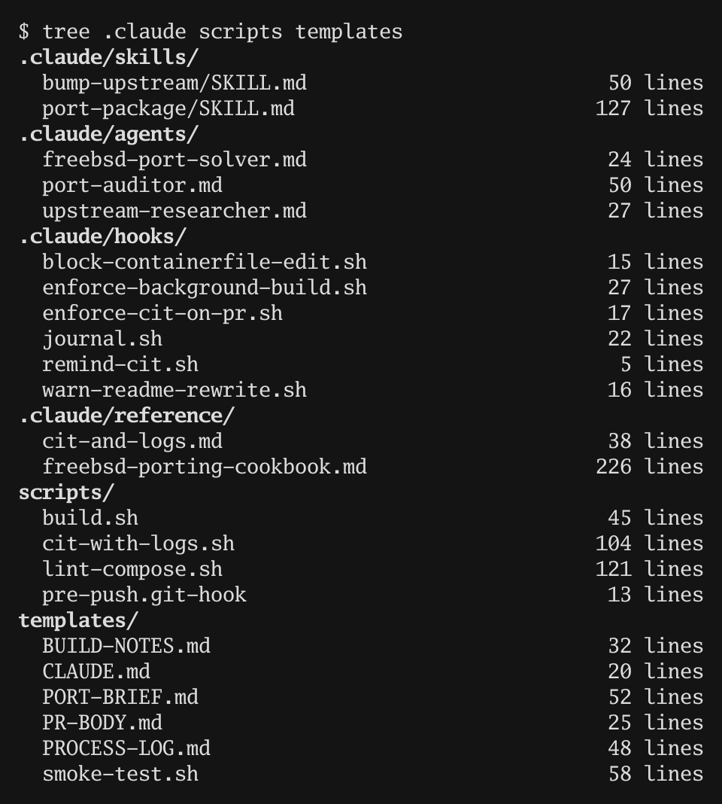

# daemonless porting toolkit

Claude Code skills, subagents, hooks and shell scripts that drive the port of an upstream app to a native FreeBSD OCI image for [daemonless](https://github.com/daemonless).

> **This is the original, Claude Code only version.** An agent-neutral rewrite was merged into the daemonless organisation as [daemonless/porting-toolkit](https://github.com/daemonless/porting-toolkit) ([PR #1](https://github.com/daemonless/porting-toolkit/pull/1), 5 November 2026). Use that one for new ports. It has a larger cookbook (39 entries against 27 here), a BSD 2-Clause licence, and it follows the current daemonless AI policy more closely. This repo stays up as the record of how the workflow started.

## Who it is for

People who want to add an image to daemonless and are willing to let an AI agent do the build loop under fixed rules. You need a FreeBSD host with [`dbuild`](https://github.com/daemonless/dbuild) and podman, `gh`, and Claude Code. Read the [daemonless AI contribution policy](https://github.com/daemonless/daemonless/blob/main/LLM_POLICY.md) first. It applies to every repo in the organisation.

## How the AI is used

It is an AI-assisted workflow. Claude does the research, the scaffold, the build loop and the first draft of the notes. The toolkit exists to stop it guessing. Every build error is looked up in a cookbook before anything else. Every non-boilerplate line in the image must trace to a written brief, a cookbook entry or a logged error. A build that exits 0 is not trusted until its log is clean, and a clean build is not trusted until the container test passes.

A person stays responsible for the result. The skill never merges. It stops for human review, and the review starts from `BUILD-NOTES.md`, which lists every FreeBSD-specific change and why it is there. The PR template ends with three "viva" questions: why this base and runtime, what the riskiest dependency is, and what breaks first on the next upstream release. In this version the agent drafts those answers and the person checks them. The daemonless copy goes further and leaves the answers and the whole PR description to the person.

## What is inside



Skills (run as slash commands in Claude Code):

| Path | What it does |
|---|---|
| [`.claude/skills/port-package/`](.claude/skills/port-package/SKILL.md) | The full port in seven phases, numbered 0 to 6: intake, research, scaffold, build loop, container test, harden, then audit and stop |
| [`.claude/skills/bump-upstream/`](.claude/skills/bump-upstream/SKILL.md) | Move an existing image to the latest upstream release and re-test it |

Subagents (each runs in its own context and returns a short report):

| Path | What it does |
|---|---|
| [`upstream-researcher.md`](.claude/agents/upstream-researcher.md) | Reads the upstream repo and returns a port plan: release tag, runtime, build steps, native modules and their FreeBSD status. Writes no files |
| [`freebsd-port-solver.md`](.claude/agents/freebsd-port-solver.md) | Takes one error that survived two fix attempts and returns one fix, plus a new cookbook entry |
| [`port-auditor.md`](.claude/agents/port-auditor.md) | Pre-PR gate. Walks every line for provenance, checks `BUILD-NOTES.md` against the files, and says what breaks first on the next bump |

Hooks (in [`.claude/settings.json`](.claude/settings.json), run by Claude Code itself rather than left to the model):

| Hook | What it does |
|---|---|
| `block-containerfile-edit.sh` | Refuses edits to the generated `Containerfile`. Only `Containerfile.j2` is edited |
| `enforce-background-build.sh` | Refuses a foreground build. A cold build outlives the tool timeout and gets killed |
| `enforce-cit-on-pr.sh` | Refuses `git push` and `gh pr create` until the container test has passed |
| `journal.sh` | Appends every shell command to `JOURNAL.log`, so a dead session leaves a record |
| `warn-readme-rewrite.sh` | Warns when `dbuild generate` has rewritten `README.md` with fork URLs |
| `remind-cit.sh` | Reminds the agent at the end of a turn that a green build is not a working image |

Scripts (plain `sh`, they work without Claude):

| Path | What it does |
|---|---|
| [`scripts/build.sh`](scripts/build.sh) | The one way to build. Refuses a stale `Containerfile`, logs to `build.log`, and greps the log for failures that `dbuild` reports as exit 0 |
| [`scripts/cit-with-logs.sh`](scripts/cit-with-logs.sh) | Runs `dbuild test`, captures the full container log that `dbuild` truncates, runs the smoke test, and writes `.cit-passed` only if both pass |
| [`scripts/lint-compose.sh`](scripts/lint-compose.sh) | Checks `compose.yaml` metadata against the `Containerfile` labels. Also flags an unpinned upstream ref, patches without `--fuzz=0` or a guard, and compilers in the runtime stage |
| [`scripts/pre-push.git-hook`](scripts/pre-push.git-hook) | Git hook that refuses a push without `.cit-passed`. It holds for any agent or person |

Reference and templates:

| Path | What it is |
|---|---|
| [`.claude/reference/freebsd-porting-cookbook.md`](.claude/reference/freebsd-porting-cookbook.md) | 27 fixes keyed by error text, each as signature, cause, fix, why |
| [`.claude/reference/cit-and-logs.md`](.claude/reference/cit-and-logs.md) | What the container test checks, and how to catch the logs it drops |
| [`templates/`](templates/) | `PORT-BRIEF.md`, `BUILD-NOTES.md`, `PROCESS-LOG.md`, `PR-BODY.md`, `smoke-test.sh` and a per-image `CLAUDE.md` |
| [`install.sh`](install.sh) | Copies the above into an image repo and installs the git hook |
| [`TESTING.md`](TESTING.md) | The test of the toolkit itself: can a mid-tier model finish a port on these files alone? |

## How a port goes

This is what `/port-package <upstream-url>` does, in order. The full text is in [`SKILL.md`](.claude/skills/port-package/SKILL.md).

1. **Intake.** Look for a `WIP.md` left by a failed session and resume from it. Find the nearest existing daemonless image to copy. Pin the latest upstream release tag. It never builds `main`.
2. **Research.** The `upstream-researcher` subagent writes a port plan. The deciding question is native modules: which dependencies ship prebuilt binaries, and does each one build on FreeBSD? If a `PORT-BRIEF.md` exists, a stronger model has already done this step and the skill skips it.
3. **Scaffold.** Copy the nearest image, write `Containerfile.j2`, run `dbuild generate`, run `lint-compose.sh`. Check every package name with `pkg rquery` before the first build, because a wrong name costs a full build cycle.
4. **Build loop.** Build in the background with `scripts/build.sh`. On any error, the first action is a literal `grep -F` of the cookbook for the error line. One fix per rebuild. An error that survives two attempts goes to `freebsd-port-solver`. If that fails too, the agent writes `WIP.md` and stops.
5. **Container test.** `scripts/cit-with-logs.sh` runs the daemonless container test and a smoke test that exercises what the app is for, not just that a port answers.
6. **Harden.** Guard every patched file so a moved upstream file fails the build loudly. Pin injected native dependencies. Keep compilers out of the runtime image.
7. **Audit, then stop.** `port-auditor` must return CLEAN. Claude Code's built-in `/code-review` runs on the diff. Then the branch and PR go up for a person to review, and the session ends.

Each new fix found along the way is appended to the local cookbook, then sent back to this repo, so the next port starts with it.

One cookbook entry, verbatim:

````markdown
### A patch silently does nothing / unpatched code ships
**Cause:** `COPY patches/x dest/x` **creates** `dest/x` if upstream moved/renamed it — unpatched source then ships and crashes.
**Fix:** guard before COPY:
```dockerfile
RUN for f in dest/a dest/b ; do test -f "$f" || { echo "PATCH DRIFT: $f gone upstream"; exit 1; }; done
```
````

## Results

Six images I added to daemonless, all reviewed and merged by a daemonless maintainer:

| Image | Upstream app | PR | Merged | Notes |
|---|---|---|---|---|
| papra | [Papra](https://github.com/papra-hq/papra), document manager | [daemonless/papra#1](https://github.com/daemonless/papra/pull/1) | 2026-06-12 | Before this repo's first commit |
| sparkyfitness | [SparkyFitness](https://github.com/CodeWithCJ/SparkyFitness), fitness tracker | [daemonless/sparkyfitness#1](https://github.com/daemonless/sparkyfitness/pull/1) | 2026-06-12 | Before this repo's first commit |
| immich-cli | Immich command-line client | [daemonless/immich-cli#1](https://github.com/daemonless/immich-cli/pull/1) | 2026-06-19 | A run-and-exit tool, tested with the `command` mode added in [dbuild#9](https://github.com/daemonless/dbuild/pull/9) |
| immich-public-proxy | [Immich Public Proxy](https://github.com/alangrainger/immich-public-proxy) | [daemonless/immich-public-proxy#1](https://github.com/daemonless/immich-public-proxy/pull/1) | 2026-07-04 | Test run 1 in [`TESTING.md`](TESTING.md). The cold run failed and a stronger model finished it |
| ffmpeg | FFmpeg | [daemonless/ffmpeg#1](https://github.com/daemonless/ffmpeg/pull/1) | 2026-07-08 | Rung 2 in [`TESTING.md`](TESTING.md). The run's outcome is not recorded there |
| actual | [Actual Budget](https://github.com/actualbudget/actual) sync server | [daemonless/actual#1](https://github.com/daemonless/actual/pull/1) | 2026-10-05 | First cold run to pass unaided ([log](https://github.com/daemonless/porting-toolkit/blob/main/docs/testing-the-toolkit.md#log-of-runs)) |

In all, 34 of my PRs have been merged across 14 daemonless repos (`gh search prs --author jtrotsky --owner daemonless --merged`, 14 November 2026). Besides the six above, they include fixes and version bumps to these images and to immich-server, immich-ml, stump and filebrowser-quantum, that `command` test mode in dbuild, fixes to the [fjord](https://github.com/daemonless/fjord) orchestrator, and a [guide to porting with AI](https://github.com/daemonless/daemonless-io/pull/13) on the daemonless site.

## Use it

From the root of an image repo, cloned into a directory named exactly after the image (`dbuild` takes the image name from the directory):

```sh
/path/to/daemonless-porting-toolkit/install.sh
claude
> /port-package https://github.com/<owner>/<repo>
```

To move an existing image to a new upstream release:

```sh
claude
> /bump-upstream
```

`install.sh --refresh` overwrites `.claude/` with the current toolkit and keeps `.claude/settings.local.json`. After install, check the hooks landed (`ls .claude/hooks/*.sh`). An older `install.sh` dropped them silently on GNU `cp`.

## Limits

- **Claude Code only.** The hooks and slash commands need it. The scripts and git hook work alone. The [daemonless copy](https://github.com/daemonless/porting-toolkit) splits the two.
- **Behind the AI policy.** Here the skill pushes the branch and opens the PR with a templated body. The daemonless policy asks for a PR description written by a person. The daemonless copy stops before the PR and leaves the description to the submitter.
- **Lightly tested on weaker models.** In this repo `TESTING.md` records one run, and it failed when the harness killed a foreground build. The daemonless copy records one later pass on `actual`. Python apps and other agents are untested.
- **Thin outside Node.** The cookbook has 27 entries: 10 for Node, 5 for Python, 12 general `dbuild` ones, and an empty Go section.
- **Needs FreeBSD.** `dbuild` and the container test run on a FreeBSD host with podman.

## Licence

This repo has no licence file yet. The daemonless copy is [BSD 2-Clause](https://github.com/daemonless/porting-toolkit/blob/main/LICENSE).
